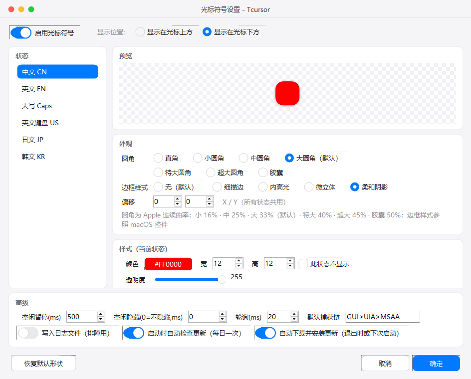
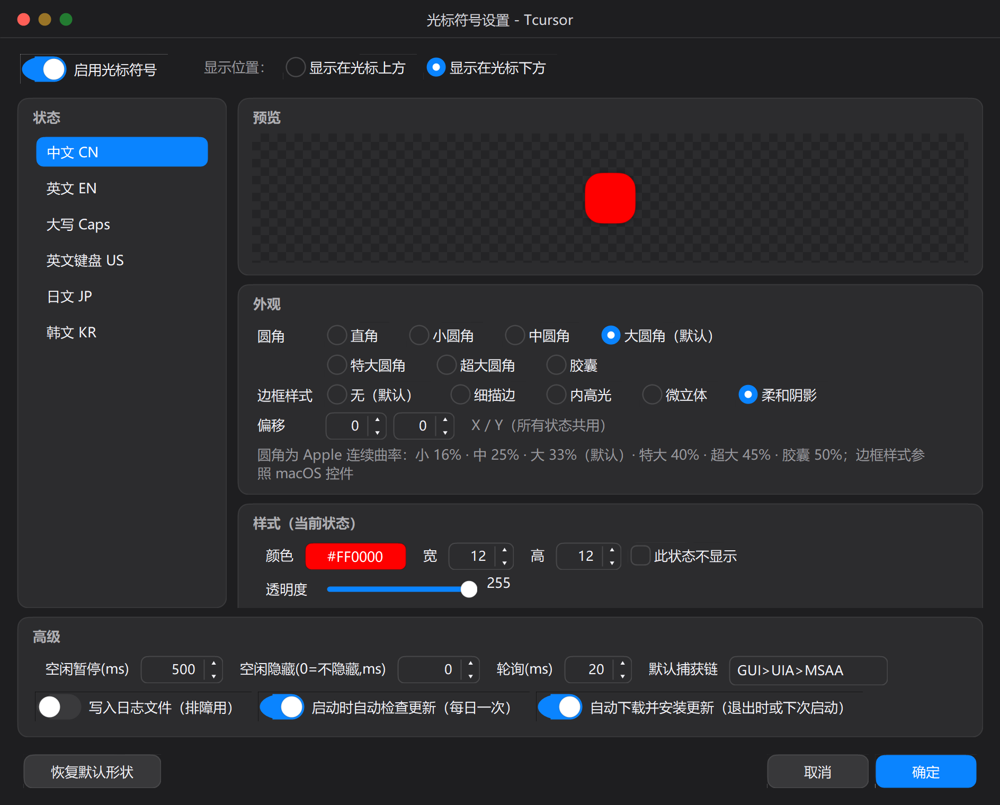
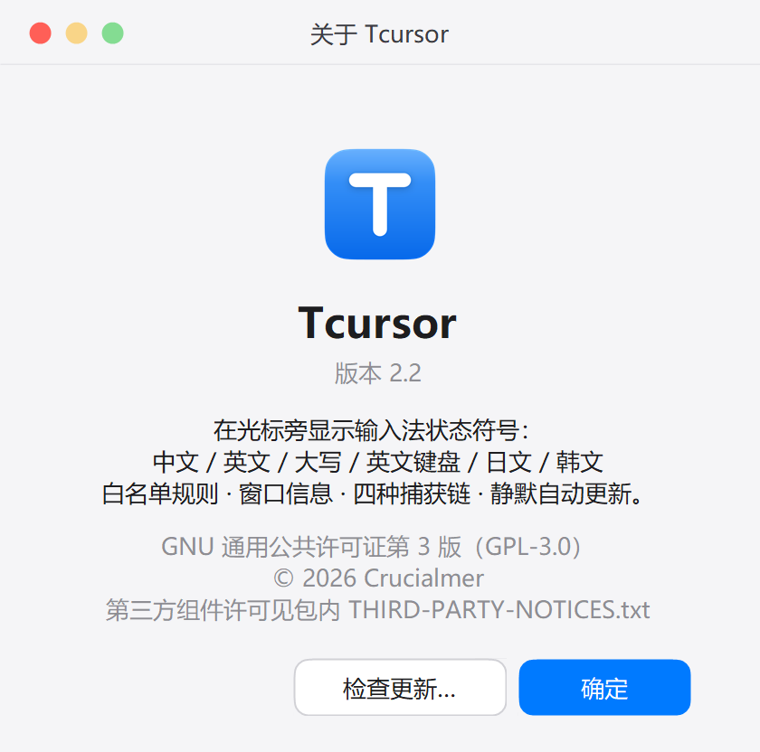

# Tcursor（输入法状态光标提示）

在光标旁显示**输入法状态符号**的 Windows 小工具：中文 / 英文 / 大写 / 英文键盘 / 日文 / 韩文六种状态，颜色与形状均可自定义。采用 C#/.NET（WinForms）实现，轻量绿色单文件，基于系统 .NET 10 官方桌面运行时；当前版本 **3.1（正式版）**；源码与构建说明见 [`dotnet/`](dotnet/README.md)。

## 下载与使用

1. 从 [Releases](https://github.com/Crucialmer/Tcursor/releases) 下载 `Tcursor.zip`（轻量单文件包，仅约 600 KB，每次启动借用系统官方 .NET 10 运行时）；
2. 解压后进入 `Tcursor` 文件夹，运行 `Tcursor.exe`（托盘常驻）；
3. 右键托盘图标 →“窗口信息”确认目标程序信息，并在“白名单规则”中添加要生效的程序（**白名单为空时不显示任何符号**）；
4. 在“光标符号设置”中调整颜色 / 尺寸 / 圆角 / 边框样式等外观。

> **自动更新**：启动时自动检查（每日一次）；发现新版本会在后台**静默下载并校验**，完成后托盘气泡提示「更新已就绪」。安装时机有三个，总有一个会生效：
> ① 点气泡 / 菜单项 → 立即装并重启（约 1 秒）；② **退出程序时** → 自动装好，下次启动即新版本（不重启）；③ **下次启动时** → 若本机还有已就绪的更新（例如上次被强制结束），启动即装好并重启一次（约 2 秒）。
> 开关在「光标符号设置 → 高级」：「启动时自动检查更新」「自动下载并安装更新（退出时或下次启动）」。

> **纯绿色便携**：默认程序目录可写时自动在本地保存 `config.json` 与 `log.txt`，真正零残留，删除软件文件夹即彻底清除；仅当安装在只读目录时安全降级至 `%LOCALAPPDATA%\Tcursor`。
> 升级自早前版本时，首次启动会自动导入原有设置。

## 界面一览

深色模式（跟随系统）：

“关于”窗口（含「检查更新」入口）：

## 特性速览

- **六种状态检测**：中文 `CN` · 英文 `EN` · 大写 `Caps` · 英文键盘 `US` · 日文 `JP` · 韩文 `KR`（CapsLock 优先；中文布局查询 IME 打开状态）
- **光标符号**：颜色 / 宽高 / 透明度 / 全局偏移；圆角 7 档（Apple 连续曲率）；5 种边框样式；逐像素透明、点击穿透、不抢焦点
- **白名单规则**：进程名 / 窗口标题 / 类名（支持正则），命中任一启用规则才显示
- **捕获链**：`GUI → UIA → MSAA → TSF` 逐级回退，覆盖 Chromium 系浏览器（输入框 / 内容可编辑区）、Windows 11 资源管理器（重命名 / 地址栏 / 搜索框）与微信 4.x 等封闭自绘应用；只在真实输入位置显示，非输入区域（网页正文 / 空白处）不显示，离开输入框立即消失
- **界面**：macOS 风格无边框窗口（自绘标题区 + 红黄绿交通灯）、180px 黄金对称紧凑托盘菜单与全自绘控件（Apple Squircle 连续曲率超椭圆、胶囊药丸分段选择器、取色器药丸、开关 / 单选 / 复选 / 滑杆 / 数字步进框 / 文本字段 / 卡片）；单一强调色、深浅色跟随系统；托盘「提示 / 信息」类窗口（窗口信息 / 关于 / 更新进度 / 消息框）统一贴在**屏幕右下角**（托盘区附近）
- **高 DPI 与主题**：全部窗口随系统 DPI 缩放（最高 500% / 8K 可容纳）；macOS 风格无边框界面；深浅色跟随系统
- **长时运行**：捕获链缓存有上限、日志按大小轮转；显示层在更新失败或显示器拓扑变化后自动重建
- **托盘常驻**：暂停 / 恢复、设置、规则管理、窗口信息、打开配置文件 / 数据目录、开机自启
- **自动更新**：托盘「检查更新…」/ 启动自动检查（每日一次）；发现新版本后台**静默下载并校验** → 气泡「已就绪」；安装时机三个（点气泡立即装+重启 / 退出时装但不重启 / 下次启动时装并重启一次），任一生效即可；开关见「高级」；用户配置与便携标记不受影响

## 目录结构

- `dotnet/Tcursor/` — 应用源码（.NET 10 + WinForms）
- `dotnet/README.md` — 构建、运行与发布说明
- `docs/` — 界面截图
- `THIRD-PARTY-NOTICES.txt` — 第三方组件许可说明

## 许可

以 **GNU 通用公共许可证第 3 版（GPL-3.0）** 发布（© 2026 Crucialmer），见 [LICENSE](LICENSE)；第三方组件许可说明见 [THIRD-PARTY-NOTICES.txt](THIRD-PARTY-NOTICES.txt)。
